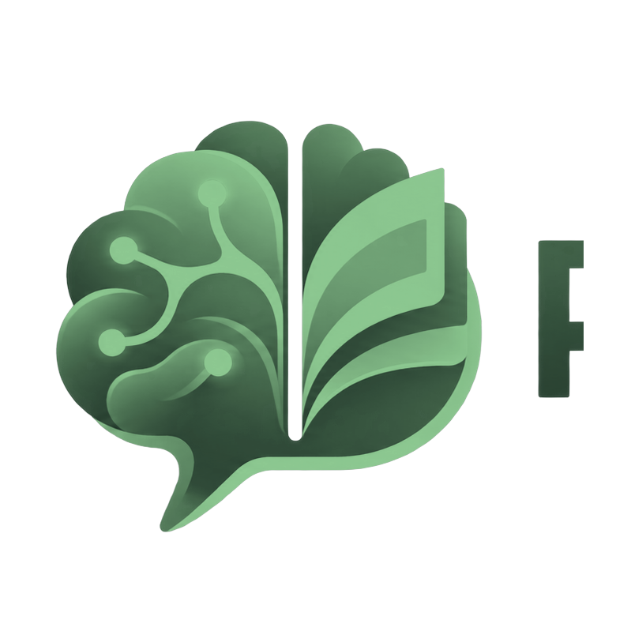
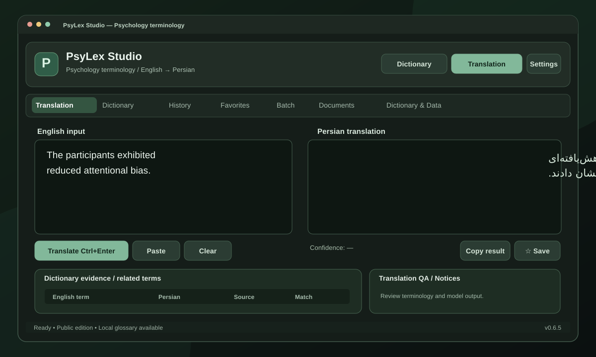
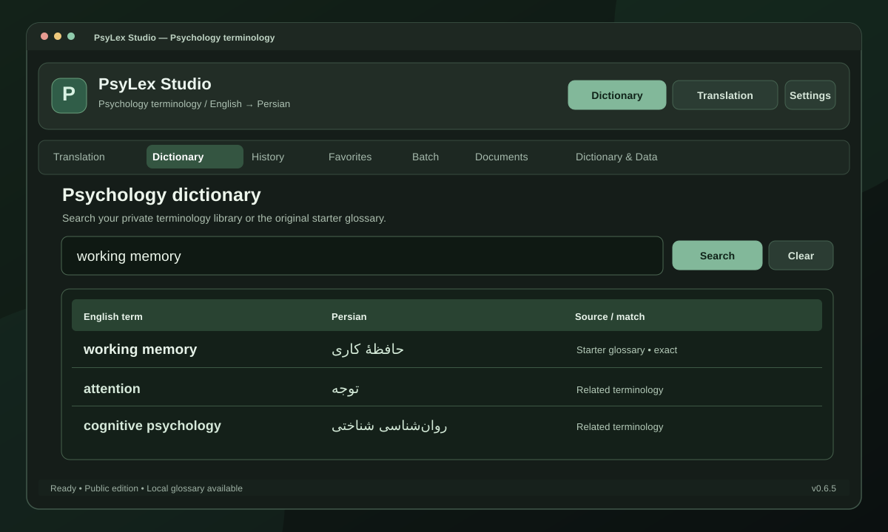
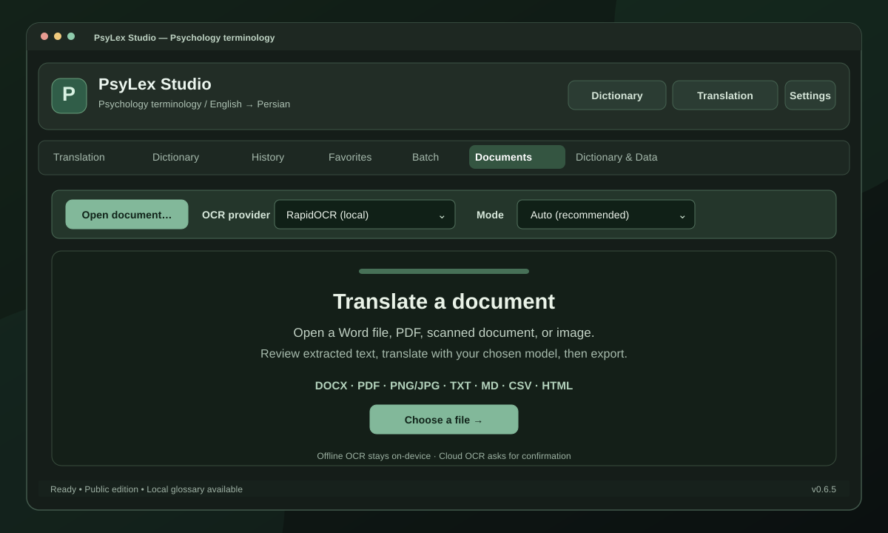

# PsyLex Studio

### English → Persian psychology terminology, translation and document intelligence

**Go beyond word-for-word translation. Preserve the meaning behind the research.**

**[⬇️ Download Windows Installer](https://github.com/aradmanamnaoon/PsyLex-Studio/releases/download/v0.6.5/PsyLexStudio-Setup-v0.6.5.exe)** · **[Explore the App](#inside-the-workspace)** · **[Build from Source](#build-from-source)** · **[Release Notes](RELEASE_NOTES.md)**

---

## Where psychology meets language

How do you translate *attentional bias*, *working memory*, or *classical conditioning* into Persian without losing their research meaning?

**PsyLex Studio** is a local-first Windows workbench for psychology students, researchers, translators, and anyone working between English and Iranian Persian. It combines terminology lookup, optional AI translation, document processing, OCR, and review in one focused desktop interface.

> **No API key is needed for offline dictionary lookup.** AI-assisted translation is optional: run a supported local model server or configure a cloud model.

## Inside the workspace

*Translation — compare English source and Persian output, then review terminology evidence.*

<table>
<tr>
<td width="50%" valign="top">

<strong>Dictionary</strong> Search terms, compare equivalents, and browse related vocabulary.

</td>
<td width="50%" valign="top">

<strong>Documents</strong> Import, extract, review, translate, and export.

</td>
</tr>
</table>

These are illustrated interface previews based on the application's workflows, not screenshots captured from a running v0.6.5 Windows installation. Actual appearance varies by theme and version.

## What can PsyLex do?

| Workspace | Capabilities |
|:--|:--|
| **Dictionary** | Offline EN–FA glossary lookup, fuzzy suggestions, and provenance-aware terminology matches. |
| **Translation** | Model-powered translation with related dictionary evidence, quality notices, copy, favorites, and feedback. |
| **Documents** | Import documents and scans, extract text, run optional OCR, review translation segments, then export. |
| **Batch** | Process lists of terminology using TXT or CSV input. |
| **History & Favorites** | Return to past translations and store frequently used results. |
| **Dictionary & Data** | Build a private terminology library by importing material you are authorized to use. |

**A practical workflow:** research text → terminology lookup → model-assisted translation → human review → export.

PsyLex keeps **retrieved dictionary entries** distinct from **generated translations**, helping you see what was found versus what the model inferred.

## Get PsyLex for Windows

### Option 1 — Download the app

**[Download PsyLexStudio-Setup-v0.6.5.exe](https://github.com/aradmanamnaoon/PsyLex-Studio/releases/download/v0.6.5/PsyLexStudio-Setup-v0.6.5.exe)**

1. Download the installer from [Releases](https://github.com/aradmanamnaoon/PsyLex-Studio/releases/tag/v0.6.5).
2. Run setup and open PsyLex Studio from the Start menu.
3. Use **Dictionary** immediately, or configure a model to enable AI translation.
4. Open **Dictionary & Data** to import additional permitted reference material.

The packaged installer includes Python. You do **not** need a separate Python installation. An unsigned build may display a Windows publisher warning; check the release provenance before proceeding.

### Option 2 — Build from source

Requires Python 3.10 and Windows. Open PowerShell in the repository root:

~~~powershell
py -3.10 -m venv .venv
.\.venv\Scripts\python.exe -m pip install --upgrade pip setuptools wheel
.\.venv\Scripts\python.exe -m pip install -e ".[dev]"
.\.venv\Scripts\python.exe main.py
~~~

For tests and the public-source security audit:

~~~powershell
.\.venv\Scripts\python.exe -m pytest -q
.\.venv\Scripts\python.exe scripts\public_release_audit.py
~~~

## Choose how your translation runs

| Local inference | Online inference |
|:--|:--|
| Connect a running **Ollama, LM Studio, llama.cpp, or vLLM** model server. | Configure a supported cloud provider such as **OpenRouter**. |
| First-launch model setup scans known local loopback endpoints. | Enter an API key in **Settings**. |
| Models and server software are installed separately. | Requests need internet access and may incur charges. |

**Model discovery detects running services**, not model weights scattered on your disks. Offline glossary lookup works independently of the chosen AI provider.

Saved API credentials use your operating system's credential store, with masked entry and Show/Hide/Forget controls.

## A note about the included dictionary

This is the **public edition**, designed for redistributable source code and installation. It includes a **small, independently prepared 16-term starter glossary** to demonstrate offline search.

It does **not** include the two third-party psychology dictionaries or the large extracted lexicon from earlier private builds. A new installation is therefore **not** a comprehensive psychology reference work.

To grow your terminology database, use **Dictionary & Data** to import dictionaries you have permission to use. Imported terms are stored for your local workflow rather than being automatically sent to GitHub.

## How it works

~~~text
PsyLex Studio  ·  PySide6 desktop GUI
    │
    ├── Dictionary → local glossary + fuzzy retrieval
    ├── Translation → local or online language model
    ├── Documents → extraction + optional OCR + review + export
    ├── History / favorites / feedback → SQLite
    └── Settings → provider profiles + OS-backed credential storage
~~~

**Technology:** Python, PySide6 / Qt, SQLite, RapidFuzz, RapidOCR + ONNX Runtime, optional LiteLLM / LangGraph workflows, PyMuPDF and python-docx.

### Build a Windows release

Run the strict release gate:

~~~powershell
.\.venv\Scripts\python.exe scripts\release_gate.py --require-windows --require-gui --require-native-ocr
~~~

With **Inno Setup 6** installed, build the installer:

~~~powershell
.\.venv\Scripts\python.exe build_installer.py --clean
~~~

The expected output is `dist\installer\PsyLexStudio-Setup.exe`. Build artifacts and private user files are intentionally excluded by [`.gitignore`](.gitignore). For release-specific details, see [RELEASE_NOTES.md](RELEASE_NOTES.md).

## Frequently asked questions

<strong>Can I use it without internet?</strong>

 
Yes for the built-in offline dictionary and supported local processing. AI translation additionally requires a running local model server. Cloud translation is optional.

<strong>Why does a fresh install contain only 16 glossary entries?</strong>

 
The public version excludes third-party book content and private extracted databases. Import your own lawfully sourced terminology to extend the library.

<strong>Why isn't my local LLM detected?</strong>

 
Start Ollama, LM Studio or another supported server, ensure a model is served on localhost, and scan again. A downloaded model file alone is not discoverable.

<strong>Can I trust OCR and AI output without checking?</strong>

 
No. Scan quality, model capabilities, and specialist terminology vary. Always review extracted text and translations before using them in academic or clinical contexts.

## Open source, carefully

- **Original application code:** [MIT License](LICENSE).
- **Third-party dependencies:** May have different obligations, including PyMuPDF's AGPL/commercial terms. Review before redistributing modified binaries.
- **Imported reference materials:** Users are responsible for their right to use them.
- **Security:** Do not commit API keys, local databases, private model files, or patient/research documents. See [SECURITY.md](SECURITY.md).
- **Status:** v0.6.5 is research/productivity software, **not a clinical decision-support tool**.

Found a reproducible bug, a terminology edge case, or an idea for improving the Persian language experience? **[Open an issue](https://github.com/aradmanamnaoon/PsyLex-Studio/issues)** with clear reproduction steps and sanitized screenshots.

---

**Made for research that crosses languages.**

[⬇ Download](https://github.com/aradmanamnaoon/PsyLex-Studio/releases/tag/v0.6.5) · [Source](https://github.com/aradmanamnaoon/PsyLex-Studio) · [Issues](https://github.com/aradmanamnaoon/PsyLex-Studio/issues)

